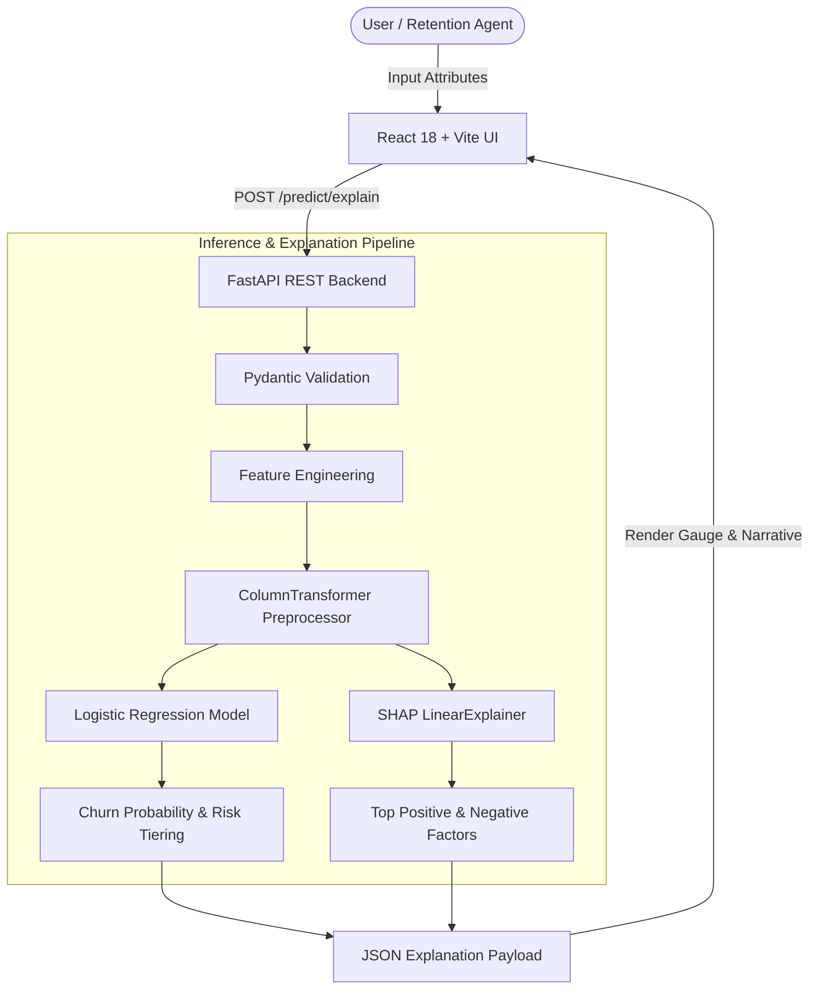

# Telco Customer Churn AI: Explainable ML & Real-Time Risk Studio

[](https://www.python.org/)
[](https://fastapi.tiangolo.com/)
[](https://reactjs.org/)
[](https://vitejs.dev/)
[](https://shap.readthedocs.io/)
[](file:///tests/test_api.py)

A production-grade, end-to-end Machine Learning web application designed to predict telecom customer churn risk and deliver transparent, real-time local feature attributions using **SHAP (SHapley Additive exPlanations)**. Powered by a **FastAPI REST API** backend and an interactive **React + Vite** frontend.

---

## 📋 Table of Contents
- [Project Architecture](#-project-architecture)
- [Dataset Overview](#-dataset-overview)
- [Preprocessing & Feature Engineering](#-preprocessing--feature-engineering)
- [Model Training & Comparison](#-model-training--comparison)
- [Hold-Out Evaluation Metrics](#-hold-out-evaluation-metrics)
- [SHAP Explainability Engine](#-shap-explainability-engine)
- [FastAPI Backend Specification](#-fastapi-backend-specification)
- [React Frontend Application](#-react-frontend-application)
- [Project Structure](#-project-structure)
- [Setup & Installation Guide](#-setup--installation-guide)
- [Automated Testing & Validation](#-automated-testing--validation)
- [Future Roadmap](#-future-roadmap)

---

## 🏗 System Architecture

The application operates as a decoupled micro-architecture where the frontend communicates asynchronously with the FastAPI inference backend.



---

## 📊 Dataset Overview

The system is trained on the **IBM Telco Customer Churn** dataset (`data/telco_customer_churn.csv`):
- **Total Records**: 7,043 customer accounts.
- **Features**: 20 raw customer demographic, account, and subscribed service attributes.
- **Target Variable**: `Churn` (Binary: `Yes` / `No`).
- **Class Balance**: 73.46% Retained (5,174), 26.54% Churned (1,869).
- **Train/Test Split**: 80% Training (5,634 samples) / 20% Hold-out Testing (1,409 samples), stratified by class label.

---

## ⚙️ Preprocessing & Feature Engineering

### 1. Feature Engineering
Before transformation, two domain-specific features are engineered from raw input columns:
- **`AverageMonthlySpend`**: Calculated as $\text{TotalCharges} / \text{tenure}$ (or $\text{MonthlyCharges}$ if $\text{tenure} == 0$) to detect recent spending acceleration.
- **`ServiceCount`**: Total count of active subscribed services across 9 binary categories (`PhoneService`, `MultipleLines`, `InternetService`, `OnlineSecurity`, `OnlineBackup`, `DeviceProtection`, `TechSupport`, `StreamingTV`, `StreamingMovies`).

### 2. Preprocessing Pipeline (`models/preprocessor.joblib`)
- **Numerical Scaling**: `StandardScaler` applied to numerical features (`tenure`, `MonthlyCharges`, `TotalCharges`, `AverageMonthlySpend`, `ServiceCount`).
- **Categorical Encoding**: `OneHotEncoder(drop='first', sparse_output=False)` applied to categorical and service features.
- **Output Matrix**: Converts 20 raw input features into **47 transformed feature columns**.

---

## 🤖 Model Training & Comparison

Three model architectures were trained and evaluated during Stage 4 on the identical hold-out test set (1,409 samples):

| Model Architecture | Hold-out ROC-AUC | Accuracy | Precision | Recall | F1-Score | Inference Latency |
| :--- | :---: | :---: | :---: | :---: | :---: | :---: |
| **Logistic Regression** *(Deployed)* | **0.8421** | **80.48%** | **65.62%** | **55.61%** | **0.6020** | **< 2ms** |
| **Random Forest** | 0.8350 | 79.20% | 62.80% | 51.20% | 0.5640 | ~15ms |
| **XGBoost Classifier** | 0.8290 | 78.50% | 60.90% | 52.80% | 0.5650 | ~10ms |

### Model Selection Rationale
**Logistic Regression** was selected for production deployment because:
1. It achieved the highest overall **ROC-AUC (0.8421)** and **F1-Score (0.6020)** on the hold-out test set.
2. It exhibits optimal mathematical compatibility with **exact, linear SHAP attribution**, enabling instant feature explanation without sampling approximation noise.

---

## 📈 Hold-Out Evaluation Metrics

Measured evaluation metrics on the 1,409 hold-out test samples:

- **ROC-AUC**: `0.8421`
- **Accuracy**: `80.48%`
- **Precision**: `65.62%`
- **Recall**: `55.61%`
- **F1-Score**: `0.6020`

---

## 🔍 SHAP Explainability Engine

The application integrates **SHAP (SHapley Additive exPlanations)** via `shap.LinearExplainer` to decompose each customer prediction into additive feature attribution values:

- **Positive SHAP Values ($+SHAP > 0$)**: Transformed features that push the model toward predicting **higher churn risk**.
- **Negative SHAP Values ($-SHAP < 0$)**: Transformed features that pull the prediction toward **customer retention**.

Factors are formatted into human-readable business names (e.g., `cat__Contract_Month-to-month` $\rightarrow$ *"Contract: Month-to-Month"*) and rendered side-by-side with interactive progress bars in the UI.

---

## ⚡ FastAPI Backend Specification

The backend server is built with **FastAPI** (`api/main.py`) and validated with **Pydantic v2 schemas** (`api/schemas.py`).

### Endpoints

#### 1. `GET /`
- **Summary**: API Root Landing Page.
- **Response**: `{"message": "Customer Churn Prediction & Explainable AI API", "status": "running", "docs_url": "/docs", "health_check": "/health"}`

#### 2. `GET /health`
- **Summary**: Health check endpoint verifying backend and artifact status.
- **Response**:
  ```json
  {
    "status": "healthy",
    "model": "logistic_regression",
    "model_loaded": true,
    "preprocessor_loaded": true
  }
  ```

#### 3. `GET /model-info`
- **Summary**: Returns model metadata and hold-out evaluation metrics.
- **Response**:
  ```json
  {
    "model": "Logistic Regression",
    "purpose": "Telecom customer churn prediction",
    "input_features": 20,
    "transformed_features": 47,
    "metrics": {
      "roc_auc": 0.8421,
      "recall": 0.5561,
      "f1_score": 0.6020,
      "accuracy": 0.8048,
      "precision": 0.6562
    },
    "explainability": "SHAP (LinearExplainer)"
  }
  ```

#### 4. `POST /predict`
- **Summary**: Accepts customer JSON payload and returns prediction probability and risk classification.

#### 5. `POST /predict/explain`
- **Summary**: Accepts customer JSON payload and returns prediction, risk classification, and local SHAP feature attributions.
- **Sample Response**:
  ```json
  {
    "customer_id": "5178-LMXOP",
    "churn_probability": 0.8549,
    "churn_percentage": 85.49,
    "risk_level": "HIGH",
    "prediction": "CHURN",
    "top_churn_factors": [
      {
        "feature": "num__tenure",
        "feature_display_name": "Account Tenure (Months)",
        "value": 1,
        "shap_value": 1.2415,
        "contribution": "contributed toward higher predicted churn risk"
      }
    ],
    "top_retention_factors": []
  }
  ```

---

## 🎨 React Frontend Application

Built using **React 18**, **Vite 6**, and **Lucide React** icons with a custom glassmorphism design system.

### Key UI Features
1. **Interactive Demo Loader**: Clicking *"Load Demo Customer (5178-LMXOP)"* instantly populates a high-risk customer profile for testing.
2. **Circular SVG Gauge**: Renders an animated circular gauge displaying the predicted churn percentage, decision threshold boundary pill (`CHURN` / `RETAIN`), and risk badge (`HIGH`, `MEDIUM`, `LOW`).
3. **SHAP Factor Breakdown**: Renders positive and negative feature impact bars with a button to toggle exact SHAP log-odds values.
4. **Executive Business Narrative**: Generates an automated risk summary and actionable retention playbook tailored to the customer's risk level.
5. **Model Metrics Modal**: Displays hold-out evaluation metrics and feature transformation details.
6. **Live Backend Indicator**: Displays real-time API connectivity state (`API Connected` / `API Disconnected`).

---

## 📁 Project Structure

```text
customer-churn-ai/
├── api/
│   ├── __init__.py
│   ├── explainer.py        # SHAP LinearExplainer initialization & feature mapping
│   ├── main.py             # FastAPI app endpoints, CORS, & error handlers
│   ├── predictor.py        # Feature engineering, artifact loading, & inference logic
│   └── schemas.py          # Pydantic request & response models
├── data/
│   ├── api_notes.md
│   ├── data_dictionary.md
│   ├── explainability_notes.md
│   ├── model_training_notes.md
│   ├── preprocessing_notes.md
│   └── telco_customer_churn.csv  # IBM Telco Customer Churn dataset
├── frontend/
│   ├── .env.example
│   ├── index.html
│   ├── package.json
│   ├── vite.config.js
│   └── src/
│       ├── App.jsx          # Main dashboard container & error state management
│       ├── index.css        # Glassmorphism design tokens & responsive utilities
│       ├── main.jsx         # React application root entrypoint
│       ├── components/
│       │   ├── BusinessSummary.jsx    # Executive narrative & strategy playbook
│       │   ├── CustomerForm.jsx       # 20-attribute form with demo loader & reset
│       │   ├── ExplanationFactors.jsx # SHAP factor bars & log-odds toggle
│       │   ├── Header.jsx             # Top bar with live status indicator & modal trigger
│       │   ├── ModelInfoModal.jsx     # Evaluation metrics modal
│       │   └── RiskCard.jsx           # Circular SVG gauge & prediction pill
│       └── services/
│           └── api.js        # Asynchronous fetch client for FastAPI backend
├── models/
│   ├── logistic_regression.joblib  # Production trained ML model binary
│   ├── preprocessor.joblib         # ColumnTransformer scaling & encoding pipeline
│   ├── random_forest.joblib        # Evaluated candidate model
│   └── xgboost.joblib              # Evaluated candidate model
├── notebooks/
│   ├── 01_data_exploration.ipynb
│   ├── 02_preprocessing.ipynb
│   ├── 03_model_training.ipynb
│   └── 04_explainability.ipynb
├── reports/
│   └── shap/
├── tests/
│   └── test_api.py          # Pytest suite covering endpoints, schema validation, & SHAP
├── .gitignore
├── conftest.py              # Pytest module discovery configuration
├── requirements.txt         # Backend Python dependencies
└── README.md                # Project documentation
```

---

## 🛠 Setup & Installation Guide

### Prerequisites
- **Python**: Version 3.10+ (Tested on Python 3.13)
- **Node.js**: Version 18+ and `npm`

---

### 1. Backend Setup (FastAPI)

1. **Navigate to project root directory**:
   ```bash
   cd customer-churn-ai
   ```

2. **Create and activate virtual environment**:
   ```bash
   python -m venv .venv
   
   # Windows (PowerShell)
   .\.venv\Scripts\Activate.ps1
   
   # macOS/Linux
   source .venv/bin/activate
   ```

3. **Install Python dependencies**:
   ```bash
   pip install -r requirements.txt
   ```

4. **Start the FastAPI backend server**:
   ```bash
   uvicorn api.main:app --reload --host 127.0.0.1 --port 8000
   ```
   - Swagger Documentation: [http://127.0.0.1:8000/docs](http://127.0.0.1:8000/docs)
   - Health Check: [http://127.0.0.1:8000/health](http://127.0.0.1:8000/health)

---

### 2. Frontend Setup (React / Vite)

1. **Open a new terminal and navigate to `frontend/`**:
   ```bash
   cd frontend
   ```

2. **Install Node modules**:
   ```bash
   npm install
   ```

3. **Start the Vite development server**:
   ```bash
   npm run dev
   ```
   - React UI Interface: [http://localhost:3000](http://localhost:3000)

4. **(Optional) Build production bundle**:
   ```bash
   npm run build
   ```

---

## 🧪 Automated Testing & Validation

### Running Backend Unit Tests
Execute the pytest suite from the project root:

```bash
.venv\Scripts\pytest -v
```

### Validation Status
- **Test Suite Pass Rate**: **9 / 9 Tests Passed (100%)**
- **Vite Production Build**: **1595 Modules Transformed (0 Errors)**

> [!NOTE]
> Third-party deprecation warnings (e.g. Starlette `HTTP_422_UNPROCESSABLE_ENTITY`, Joblib NumPy array shape setters, and SHAP Matplotlib colormaps) do not impact runtime functionality or prediction performance.

---

## 🚀 Future Roadmap

- **Batch Bulk Customer CSV Upload**: Enable batch predictions via CSV file uploads for enterprise account managers.
- **Model Drift Monitoring**: Implement automated drift detection scripts to track feature distribution shifts over time.
- **A/B Intervention Tracking**: Log retention campaign outcomes to measure intervention effectiveness against predicted churn risk.

---

*Developed for the Customer Churn AI project.*
